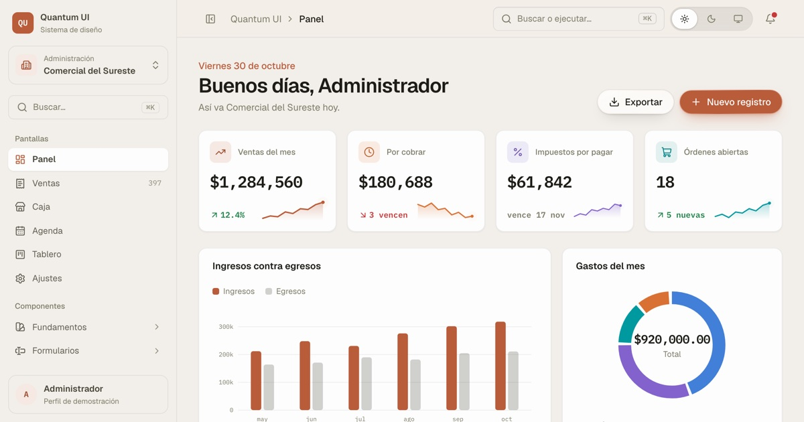

# Frontend Base

[](https://github.com/JuanNoh/frontend-base/actions/workflows/ci.yml)

Incluye **Quantum UI**, su sistema de diseño: [ver la demo](https://quantum-ui.pages.dev/ui).



Plantilla base para los proyectos frontend nuevos (2026 en adelante). Nace de las
convenciones que ya funcionaban bien en proyectos anteriores, pero con el stack
moderno: las ideas se quedan, las herramientas se actualizan.

## Pantallas incluidas

Ejemplos completos para copiar y adaptar. Cambia de empresa en el menú y el giro, los datos y el color cambian en toda la plantilla.

| Ruta          | Pantalla | Qué muestra                                     |
| ------------- | -------- | ----------------------------------------------- |
| `/ui`         | Panel    | Indicadores, gráficas y pendientes del negocio  |
| `/ui/ventas`  | Ventas   | Tabla con filtros, columnas y detalle lateral   |
| `/ui/caja`    | Caja     | Punto de venta con ticket y cobro en efectivo   |
| `/ui/agenda`  | Agenda   | Semana con citas, alta y filtro por persona     |
| `/ui/tablero` | Tablero  | Kanban con arrastre, y menú para teclado o dedo |
| `/ui/ajustes` | Ajustes  | Empresa, equipo, apariencia y avisos            |

El catálogo de componentes vive en `/ui/fundamentos`, `/ui/formularios`, `/ui/superficies`, `/ui/datos` y `/ui/efectos`. Cada sección tiene un botón **Ver código** con el archivo real del ejemplo y sus tipos.

## Stack

| Antes                                        | Ahora                           | Por qué                                                                                   |
| -------------------------------------------- | ------------------------------- | ----------------------------------------------------------------------------------------- |
| `useForm` casero (276 líneas)                | **react-hook-form**             | Misma API (`register` ≈ `getFieldProps`), pero mantenida, tipada y sin re-renders         |
| `stringSchema`/`numberSchema` caseros        | **zod 4**                       | Mismo builder fluido que ya usábamos, y `z.infer` regala el tipo del form                 |
| axios + interceptores                        | **ky**                          | fetch nativo con hooks; mismo patrón de Bearer + logout en 401                            |
| Redux Toolkit + redux-persist + facade hooks | **zustand + persist**           | El slice, el facade y el persist son UN archivo; `getState()` fuera de React incluido     |
| `useState` + `useEffect` + `refreshTable`    | **TanStack Query**              | Cache, loading, reintentos e invalidación gratis; adiós efectos de fetch                  |
| react-router-dom + ProtectedRoute            | **TanStack Router**             | Rutas file-based 100% tipadas; guards en `beforeLoad` sin flash de contenido              |
| `${base} ${variant} ${className}`            | **cva + clsx + tailwind-merge** | Variantes declarativas y `cn()` resuelve conflictos de clases                             |
| slices `alert`/`alert-modal` de redux        | **sonner**                      | un `<Toaster>` global en `__root` y `toast.success()/error()` desde donde sea             |
| modal/select/datepicker hechos a mano        | **Radix UI**                    | el motor de shadcn: focus trap, ARIA, ESC y portal gratis; el estilo sigue siendo nuestro |
| dayjs                                        | **date-fns 4**                  | Tree-shakeable y con soporte de timezones nativo                                          |
| Sin alias, `../../../../..`                  | **alias `@/`**                  | Se acabó el infierno de puntitos                                                          |

Base: **Vite 8 + React 19 + TypeScript 7 + Tailwind CSS 4** (CSS-first, sin
`tailwind.config.js`). Manager: **pnpm**. Íconos **lucide-react**, animación
**motion** + **tw-animate-css**, color con **chroma-js**, letra **Geist** con cifras en
**IBM Plex Mono**.

### TypeScript 7 y 6 lado a lado

TS 7 es el compilador nativo (Go): el `tsc -b` del build corre ~5× más rápido aquí y
hasta 10× en proyectos grandes. Todavía no trae API programática (llega en 7.1), y
typescript-eslint la necesita, así que se usan los dos con el esquema oficial:

```json
"@typescript/native": "npm:typescript@^7.0.2",
"typescript": "npm:@typescript/typescript6@~6.0.2"
```

`tsc` = TS 7 (build, typecheck, CI). El paquete `typescript` = TS 6 (ESLint y lo que
importe la API). Cuando salga 7.1 y typescript-eslint lo soporte, se quita el alias.

## Correr el proyecto

```bash
cp .env.example .env   # el demo apunta a jsonplaceholder, jala sin backend
pnpm install
pnpm dev
```

El demo: login falso (cualquier correo + contraseña de 8+) → **Quantum UI** en
**`/ui`**, el sistema de diseño con todos los componentes, temas y efectos juntos.

## Tema y apariencia

Todo el look sale de `src/styles/theme.css`:

- **Grises con tono** (taupe, mist u olive de Tailwind 4.2) y **un acento de cualquier
  color**: de él sale una escala completa 50 → 950 (`lib/palette/`, usa las familias de
  Tailwind CSS v3.4 como molde, MIT © Tailwind Labs). El hover, los fondos suaves, la
  versión oscura y el color del texto encima se derivan solos y siempre se leen.
- **Claro, oscuro o sistema** con la clase `.dark` en `<html>`. Un script en
  `index.html` aplica la preferencia guardada antes de montar React, así no parpadea.
- **Tres formas** (`data-shape`: suave, equilibrada, compacta) que cambian radios y
  alturas de todos los componentes a la vez.
- **Botones líquidos**: relleno plano y filo de luz por fuera (utilidad `liquid-rim`),
  como los controles de Apple.

La preferencia vive en `stores/appearance.store.ts` (zustand + localStorage). Para
darle a un cliente su color: `useAppearanceStore.getState().setAccent('#1d6fa5')`.

## Estructura

```
src/
├── main.tsx                 # providers: QueryClient + Router
├── index.css                # importa tailwind + theme
├── routeTree.gen.ts         # GENERADO por el router plugin, ni tocarlo
├── routes/                  # SOLO cableado: guard + qué page pinta
│   ├── __root.tsx
│   ├── index.tsx            # / → login
│   └── ui.tsx               # /ui → Quantum UI
├── features/                # la carne — una carpeta por dominio de negocio
│   └── <dominio>/
│       ├── <dominio>.page.tsx  # la page: solo compone
│       ├── components/      # subcomponentes de la feature
│       ├── hooks/           # orquestación (useFacturas)
│       ├── api/             # la ÚNICA capa que conoce URLs (el use-case de antes)
│       ├── adapters/        # frontera backend crudo ↔ forma de UI (funciones puras)
│       ├── schemas/         # schemas de zod (los validators de antes)
│       └── types/           # XResponse (crudo) vs X (limpio)
├── components/
│   ├── layout/              # shells de página (AppShell con menú y barra superior)
│   └── ui/                  # el components/common de antes
│       └── button/
│           ├── button.component.tsx
│           ├── button.styles.ts    # cva
│           └── button.types.ts
├── stores/                  # zustand: SOLO estado global real (auth, apariencia)
├── lib/                     # infra compartida: api-client, query-client, cn()
└── styles/theme.css         # tokens OKLCH, claro/oscuro, formas y @theme
```

## Convenciones (las reglas del juego)

1. **Un archivo = una responsabilidad**, con sufijo por punto:
   `.component.tsx` · `.page.tsx` · `.types.ts` · `.styles.ts` · `.utils.ts` ·
   `.api.ts` · `.adapter.ts` · `.schema.ts` · `.store.ts`
2. **Carpetas en kebab-case**; hooks en camelCase con prefijo `use` (`useLoginForm.ts`).
3. **Capas estrictas**: componente → hook → `api/` → `apiClient`.
   La vista JAMÁS importa `apiClient` ni conoce URLs ni la forma cruda del backend.
4. **Adapters como frontera de nombres**: el backend habla snake_case, la UI
   camelCase; la traducción vive en `adapters/` y en ningún otro lado. Funciones
   puras, sin JSX (el JSX se pinta en el componente, así el adapter es testeable).
5. **La page solo compone**; el hook orquesta; la ruta solo cablea.
6. **Tokens semánticos** en `@theme`: `bg-primary`, `text-danger`, `border-line`.
   Nombres por ROL, no por color — si mañana la marca es azul, cambias un hex y
   las clases siguen diciendo la verdad.
7. **Tipos sin prefijo `I`** y con `ComponentProps<'button'>` para extender lo
   nativo. React 19: `ref` es prop normal, no se usa `forwardRef`.
8. **Estado**: TanStack Query para TODO lo que venga del servidor; zustand solo
   para estado global real de UI (sesión, apariencia); `useState` para lo local. Redux ya no.
9. **Named exports** en todo (componentes, hooks, pages). Sin barrels `index.ts`
   salvo que un import se vuelva insufrible.
10. **Nada de `any`** (ESLint lo marca error). Si de veras se ocupa, disable con
    comentario explicando por qué.

## Recetas rápidas

**Nueva feature con lista del backend:**
`features/<nombre>/` con `types/` (Response + limpio) → `adapters/` → `api/` →
`hooks/useX.ts` con `useQuery` → `x.page.tsx` → ruta en `routes/`.

**Nuevo formulario:**
`schemas/x.schema.ts` con zod → `useXMutation` (estado de servidor, separado) →
`useXForm` con `useForm` + `zodResolver` que consume la mutación → componente
que solo hace `{...register('campo')}` y pinta `errors`. Ver `features/auth`.

**Mutación que refresca una lista:**

```ts
const queryClient = useQueryClient();
useMutation({
	mutationFn: createThing,
	onSuccess: () => queryClient.invalidateQueries({ queryKey: ['things'] }),
});
```

(esto reemplaza el `refreshTable`/`setRefreshTable` de antes)

**Dónde van los efectos de una mutación:**

- En el `useMutation` del hook (`useXMutation`): lo que aplica SIEMPRE que
  pegue, la llame quien la llame — guardar en store, `invalidateQueries`.
- En el call-site `mutate(values, { onSuccess })`: lo de ESA pantalla —
  navegar, toasts. Estos callbacks no corren si el componente ya se desmontó
  (justo lo que quieres pa' una navegación). Orden: primero el del hook,
  luego el del call-site.
- Colocar la mutación dentro del hook del form solo se vale si es de un solo
  uso y cabe en ~10 líneas. En duda: separa.

**Nuevo componente UI:**
carpeta en `components/ui/<x>/` con:

- `x.types.ts`: props (`ComponentProps<'x'> & VariantProps<...>`).
- `x.styles.ts`: TODAS las clases con cva, aunque no haya variantes; una
  exportación por pieza (`xStyles`, `xItemStyles`…), solo con tokens del tema.
- `useX.ts` / `x.utils.ts`: estado, efectos o funciones puras, si los hay.
- `x.component.tsx`: solo pinta con `cn(xStyles(), className)`.

Luego agrégalo a Quantum UI (`/ui`) y pruébalo en claro, oscuro y las tres formas.

**Nuevo componente UI con comportamiento** (modal, select, dropdown, tabs):
primitiva de Radix (`import { Dialog } from 'radix-ui'`) + estilo nuestro con
Tailwind. No copiamos los componentes de shadcn — usamos su motor y el diseño
es de la casa. Ver `components/ui/modal`.

**Toasts/alertas:**
`toast.success('...')` / `toast.error('...')` de sonner, desde donde sea (el
`<Toaster>` ya vive en `__root.tsx`). Son efectos de pantalla: van en el
call-site del `mutate`, no dentro del `useMutation`.

## Listas con backend

Un solo hook sirve para cualquier API. Eliges el formato sin editarlo:

```bash
VITE_PAGINATION=node
```

```ts
const list = usePaginatedQuery<Invoice>({
	queryKey: ['facturas'],
	fetchPage: listInvoices,
});
```

```tsx
<DataTable rows={list.rows} columns={COLUMNS} getRowId={getId} server={list.table} />
```

| Formato       | Pide                     |
| ------------- | ------------------------ |
| `dotnet`      | `pageNumber`, `pageSize` |
| `dotnet-page` | `page`, `pageSize`       |
| `node`        | `page`, `limit`          |
| `offset`      | `offset`, `limit`        |

Para una sola pantalla: `paginate: 'node'`. Para una API con otros nombres:
`paginate: { firstPage: 0, pageSizeParam: 'size' }`.

La respuesta se lee sola: reconoce `items`, `data`, `results`, `content`, `rows` o
`records`, y `totalCount`, `total`, `count`, `totalElements` o `meta.total`, también
envueltas en `data` o `result`.

## Para cualquier negocio

Quantum UI muestra los mismos componentes en cinco giros: administración, punto de
venta, recursos humanos, citas y logística. Cada giro es un archivo de datos en
`features/quantum-ui/data/verticals/`; agregar otro no toca los componentes.

## Comandos

```bash
pnpm dev          # dev server
pnpm build        # vite build + typecheck
pnpm typecheck    # solo tsc
pnpm lint         # eslint (0 warnings permitidos)
pnpm format       # prettier a todo src/
```

## Calidad en 3 candados

1. **Pre-commit**: husky corre lint-staged (eslint --fix + prettier) sobre lo staged —
   lo que se commitea ya va formateado.
2. **Pre-push**: `pnpm prettier && pnpm lint && pnpm build` tienen que pasar en verde,
   si no, el push no sale.
3. **CI (GitHub Actions)**: los mismos checks corren en la nube en cada push y PR.

## Licencia

[MIT](LICENSE)
